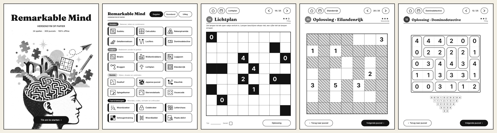
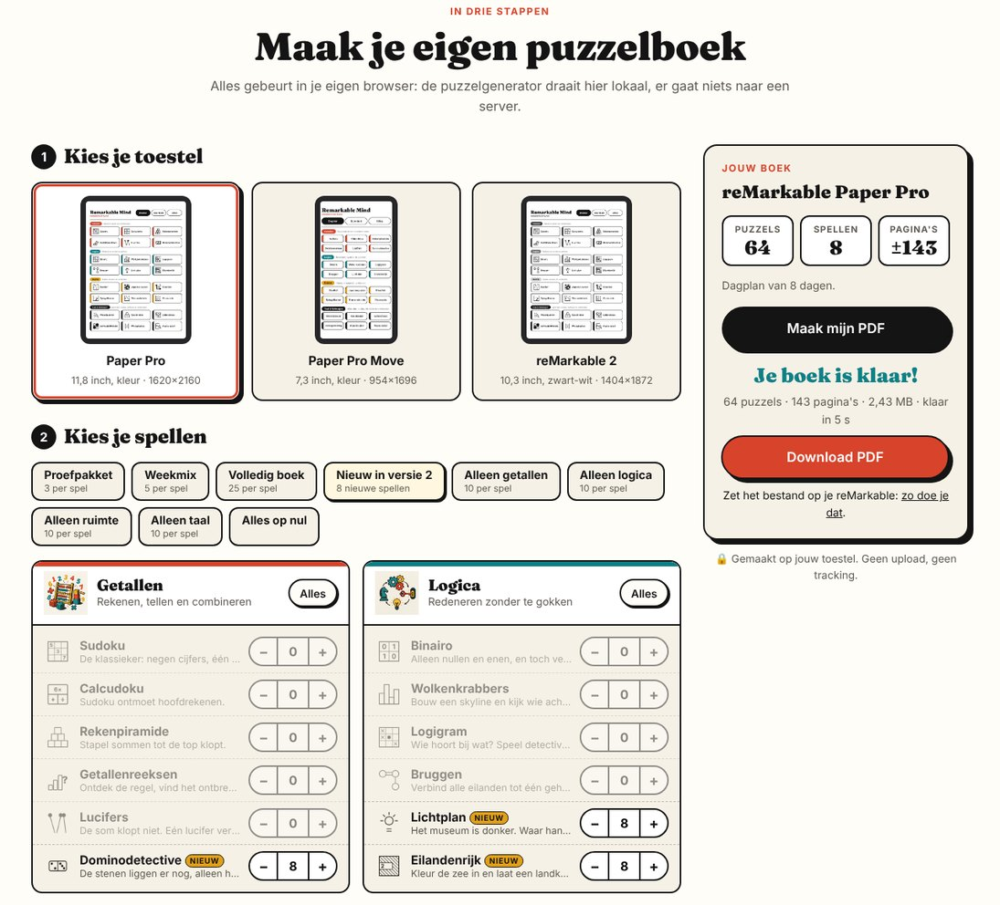

# Remarkable Mind

**Hersengym op papier** — 24 hersenspellen, 600 puzzels en een trainingsplan van 30 dagen, volledig offline op de reMarkable Paper Pro (kleur), de Paper Pro Move (kleur, 7,3") en de reMarkable 2 (zwart-wit).


| | |
|---|---|
| **De app voor de Paper Pro** | [`dist/RemarkableMind.pdf`](dist/RemarkableMind.pdf) — kleur, 1.258 pagina's, 8.882 tikbare links, 6,4 MB |
| **De app voor de Paper Pro Move** | [`dist/RemarkableMind-Move.pdf`](dist/RemarkableMind-Move.pdf) — kleur, pagina's in 9:16, 1.264 pagina's, 6,7 MB |
| **De app voor de reMarkable 2** | [`dist/RemarkableMind-rM2.pdf`](dist/RemarkableMind-rM2.pdf) — grijstinten, zelfde 600 puzzels, 6,1 MB |
| **De website** | [`web/public`](web/public) — stel je eigen boek samen in de browser, gehost op Cloudflare (zie [De website](#de-website)) |
| **De promofilm** | [`promo/RemarkableMind-promo.mp4`](promo/RemarkableMind-promo.mp4) — 66 seconden, Nederlands gesproken |

## Wat is het?

De reMarkable heeft geen app-store. Remarkable Mind is daarom gebouwd als één
interactieve PDF: elke knop is een link, je navigeert door te tikken en je lost
op met je pen. Dat werkt op een standaard toestel, zonder developer mode,
zonder account en zonder netwerk.

- **24 spellen in 4 denkspieren**, zes per spier (**vet** = nieuw in versie 2)
  - *Getallen*: Sudoku, Calcudoku, Rekenpiramide, Getallenreeksen, Lucifers,
    **Dominodetective**
  - *Logica*: Binairo, Wolkenkrabbers, Logigram, Bruggen, **Lichtplan**,
    **Eilandenrijk**
  - *Ruimte*: Doolhof, Japanse puzzel, Kleurlink, **Spiegelkamer**,
    **Sterrenstelsels**, **Vouwcode**
  - *Taal & Geheugen*: Woordzoeker, Codekraker, Letterchaos, Geheugentraining,
    **Woordladder**, **Plaats delict**
- **600 puzzels** in drie niveaus (Opwarmen, Pittig, Meesterlijk), 25 per spel.
- **Eén oplossing, nooit gokken**: elke logische puzzel is door een solver
  nagerekend op precies één oplossing.
- **30 dagen hersengym**: elke dag vier puzzels, één per denkspier, met
  oplopende moeilijkheid en afvinkvakjes.
- **Gemaakt voor kleuren-e-ink**: pagina's op exact schermformaat (3:4),
  vette steunkleuren, vectorlijnen, grote tik- en schrijfvlakken.
- **Oplossingen achteraan**, bereikbaar via de knop *Oplossing* op elke puzzel,
  in blauw "handschrift".

## Nieuw in versie 2

Acht extra spellen, elk met een eigen generator en een solver die de unieke
oplossing bewijst:

| Spel | Wat doe je? | Niveaus |
|---|---|---|
| **Plaats delict** | Zet de verdachten op een plattegrond met aanwijzingen als *"De tuinman kon de trap zien"* en ontmasker wie alleen bij de buit stond. Twaalf decors, van museum tot sterrenwacht. | 4×4, 5×5, 6×6 |
| **Spiegelkamer** | Teken precies het opgegeven aantal spiegels zodat de lichtstraal langs alle voorwerpen naar de uitgang loopt. | 2, 3 of 4 spiegels |
| **Sterrenstelsels** | Verdeel het rooster in gebieden rond de stippen; elk gebied past na een halve draai op zichzelf. | 5×5, 7×7, 9×9 |
| **Lichtplan** | Hang lampen in het donkere museum: alles verlicht, geen lamp beschijnt een andere, de cijfers tellen de lampen ernaast. | 6×6, 8×8, 10×10 |
| **Dominodetective** | Teken de verdwenen randen van de dominostenen terug; elke combinatie komt precies één keer voor. | dubbel-3, -4, -6 |
| **Eilandenrijk** | Kleur de zee: eilanden met de opgegeven oppervlakte, één verbonden zee zonder blok van 2×2. | 5×5, 6×6, 7×7 |
| **Woordladder** | Verander telkens één letter en maak bij elke stap een bestaand woord. Op niveau 3 met een verplicht tussenwoord. | 3 of 4 letters |
| **Vouwcode** | Het blad wordt gevouwen en geprikt; teken waar de gaatjes zitten als het weer open ligt. | 1, 2 of 3 vouwen |

Het startscherm, het scorebord en het overzicht van de oplossingen zijn
herschikt voor 24 spellen, en Lucifers is verhuisd naar *Getallen*. Op de
website kies je met de knop *Nieuw in versie 2* in één tik de acht nieuwe
spellen.

## Welk toestel?

Elke editie heeft pagina's in exact de verhouding van het scherm, zodat ze het
hele scherm vullen:

| | Paper Pro | Paper Pro Move | reMarkable 2 |
|---|---|---|---|
| Scherm | 11,8 inch, kleur | 7,3 inch, kleur | 10,3 inch, zwart-wit |
| Resolutie | 1620 × 2160 (3:4) | 954 × 1696 (9:16) | 1404 × 1872 (3:4) |
| Bestand | `RemarkableMind.pdf` | `RemarkableMind-Move.pdf` | `RemarkableMind-rM2.pdf` |

**Paper Pro Move.** Het smalle 9:16-scherm krijgt een eigen, compactere
opmaak: een navigatiebalk met pictogrammen, compacte tegels, en de uitleg,
het dagplan en het scorebord verdeeld over meer pagina's. Een aantal spellen
maakt er kleinere varianten zodat de vakjes groot genoeg blijven om in te
schrijven: de Japanse puzzel (15×15 in plaats van 20×20), het logigram (3 in
plaats van 4 categorieën op niveau 3), de woordzoeker (tot 12×12),
Letterchaos (minder en kortere woorden), Lichtplan (tot 8×8),
Sterrenstelsels (tot 7×7), Dominodetective (dubbel-5 op niveau 3) en
Plaats delict (5×5 op niveau 3).

**reMarkable 2.** Dit toestel toont geen kleur; zijn editie is daarom apart
opgebouwd in grijstinten die op het scherm van elkaar te onderscheiden
blijven:



| | Paper Pro | reMarkable 2 |
|---|---|---|
| Scherm | 11,8 inch, kleur, 1620 × 2160 | 10,3 inch, zwart-wit, 1404 × 1872 |
| Categorieën | vier steunkleuren | vier grijstinten, naam staat er altijd bij |
| Oplossingen | blauw "handschrift" | grijs "handschrift" |
| Kleurlink | gekleurde stippen met letter | zwarte stippen met letter, paden in twee grijzen |
| Doolhof | route in blauw | route als brede grijze band |
| Geheugentraining | vormen in kleur | vormen in zwart, grijs en wit |
| Illustraties | vier inkten | grijsversie waarin de vier inkten te onderscheiden blijven |

De logische puzzels zijn in beide edities identiek. Alleen de vormenpuzzels
van Geheugentraining verschillen, omdat ze daar naar tinten vragen in plaats
van naar kleuren. Door het kleinere scherm is alles op de reMarkable 2 ongeveer
13% kleiner dan op de Paper Pro.

## Op je reMarkable zetten

1. Download [`dist/RemarkableMind.pdf`](dist/RemarkableMind.pdf) (Paper Pro),
   [`dist/RemarkableMind-Move.pdf`](dist/RemarkableMind-Move.pdf) (Paper Pro Move)
   of [`dist/RemarkableMind-rM2.pdf`](dist/RemarkableMind-rM2.pdf) (reMarkable 2),
   of stel je eigen boek samen op de website.
2. Sleep het bestand in de reMarkable-app (desktop of mobiel), of zet het
   over via USB (in *Settings → Storage* de *USB web interface* aanzetten en
   in je browser naar `http://10.11.99.1` gaan).
3. Open het boek, verberg de werkbalk en tik op *Tik om te starten*.

Tips: tik met je vinger op knoppen, schrijf met de pen. Je inkt staat los van
het boek, dus wissen of een nieuwe laag gebruiken maakt een puzzel weer leeg.

## Zelf een nieuwe editie bouwen

Elke editie is een compleet nieuw boek met 600 andere puzzels.

```bash
pip install -r requirements.txt
```

```bash
python -m mind.book --seed 2027 --out dist/RemarkableMind-2027.pdf
```

Dezelfde editie voor de reMarkable 2 (`--device rm2`) of de Paper Pro Move
(`--device move`):

```bash
python -m mind.book --seed 2027 --device rm2 --out dist/RemarkableMind-2027-rM2.pdf
```

Een eigen selectie: kies spellen en aantallen, één niveau, zonder dagplan of
oplossingen:

```bash
python -m mind.book --device move --games sudoku:10,doolhof:6,codekraker:4 --difficulty 2 --no-plan
```

```bash
python -m pytest -q
```

Eén spel bekijken op schermresolutie (voeg `--device move` of `--device rm2`
toe voor de andere toestellen):

```bash
python -m mind.preview sudoku --out build/preview
```

## Hoe het in elkaar zit

```
mind/
  theme.py        formaat, kleuren, lettertypes en de toestelprofielen
  draw.py         tekenhulpen (rooster, knoppen, pictogrammen)
  pages.py        navigatiebalk, puzzel- en oplossingspagina
  book.py         cover, startscherm, hubs, dagplan, scorebord + PDF-opbouw
  games/          één module per spel: generate(), verify(), draw(), icon()
  assets/         e-ink-versies van de illustraties
  fonts/          Fraunces, Inter, Caveat (SIL OFL)
tests/            per spel: geldig, uniek, deterministisch; plus navigatie,
                  toestellen en de websitebundel
promo/            artwork, clips, voice-over, muziek en make_film.py
web/public/       de website (statische bestanden, zie hieronder)
tools/            prepare_assets.py, build_web.py
wrangler.jsonc    Cloudflare-configuratie van de website
```

Een nieuw spel toevoegen is één bestand in `mind/games/` dat de klasse `Game`
uit `mind/games/base.py` invult, plus de sleutel in `ORDER` in
`mind/games/__init__.py`.

## De website



Op de website stel je je eigen boek samen: kies je toestel, per spel hoeveel
puzzels (0 tot 30), het niveau, en of je een dagplan en oplossingen wil.
Daarna download je de PDF.

**Alles draait in de browser.** De Python-generator uit `mind/` loopt via
[Pyodide](https://pyodide.org) (Python in WebAssembly) in een Web Worker op het
toestel van de bezoeker. Er is dus geen server, geen upload en geen
wachtrij, en het boek is identiek aan dat van `python -m mind.book`. Het
volledige boek van 600 puzzels is in ongeveer 20 seconden klaar, een kleine
selectie in 3 à 5 seconden. Een service worker bewaart de rekenmotor, zodat
de site na het eerste bezoek ook offline werkt.

| Bestand | Wat |
|---|---|
| `web/public/index.html`, `css/`, `js/app.js` | de interface |
| `web/public/js/engine.js` | Web Worker: laadt Pyodide, Pillow en de generator, bouwt de PDF |
| `web/public/pyodide/` | zelf gehoste Pyodide-runtime met de Pillow-wheel |
| `web/public/py/` | `app.<hash>.zip` (de `mind`-package + reportlab) en `manifest.json` |
| `web/public/downloads/` | de drie kant-en-klare edities |
| `wrangler.jsonc` | Cloudflare Worker die alleen deze statische bestanden serveert |

Na een wijziging in `mind/` bouw je de site opnieuw (de test
`tests/test_web.py` faalt zolang de bundel achterloopt):

```bash
python tools/build_web.py
```

Lokaal draaien met dezelfde runtime als Cloudflare:

```bash
npm install
```

```bash
npx wrangler dev
```

### Op Cloudflare zetten

Alle bestanden staan al in de repo; Cloudflare hoeft niets te bouwen. Koppel de
repo eenmalig aan Workers Builds, daarna deployt Cloudflare bij elke push:

1. Ga in het [Cloudflare-dashboard](https://dash.cloudflare.com/?to=/:account/workers-and-pages/create)
   naar **Workers & Pages → Create application → Import a repository**.
2. Kies GitHub en de repo `vdsjan/remarkable_mind`.
3. Projectnaam: **`remarkable-mind`** (moet gelijk zijn aan `name` in
   `wrangler.jsonc`). Build command: leeg. Deploy command: `npx wrangler deploy`.
4. Kies de branch waarvan je wil deployen en klik **Save and Deploy**.

De site staat daarna op `https://remarkable-mind.<jouw-subdomein>.workers.dev`.
Met een API-token kan het ook rechtstreeks: `npx wrangler deploy`.

## De promofilm

`promo/make_film.py` monteert de film volledig uit code:

- vier geanimeerde scènes en al het artwork zijn gegenereerd met ElevenLabs
  (beeld → video), in één risografie-stijl met vier inkten;
- de voice-over (Vlaamse stem) en de muziek komen van ElevenLabs;
- alle schermen in de film zijn echte pagina's uit de PDF;
- de montage volgt de muziek: de onrustige intro eindigt op 5,7 s, de groove
  start op 11,4 s en het slotakkoord valt op 62,9 s.

```bash
python promo/make_film.py
```

De film is gemaakt bij versie 1 en noemt daarom nog 16 spellen en 400
puzzels.

## Credits

- Illustraties, videoclips, stem en muziek: gegenereerd met ElevenLabs.
- Lettertypes: Fraunces, Inter en Caveat (SIL Open Font License, zie `mind/fonts/`).
- Woordenlijst van Woordladder: samengesteld uit de
  [OpenTaal-woordenlijst](https://www.opentaal.org) (BSD / CC BY 3.0).
- De nieuwe spellen zijn eigen uitwerkingen van bekende puzzeltypes: Akari
  (Lichtplan), Nurikabe (Eilandenrijk), Galaxies (Sterrenstelsels), Dominosa
  (Dominodetective) en de woordladder van Lewis Carroll; Plaats delict is
  geïnspireerd op Murdoku.
- PDF: ReportLab en PyMuPDF.

reMarkable is een merk van reMarkable AS. Dit is een onafhankelijk project,
niet verbonden met of goedgekeurd door reMarkable AS.
