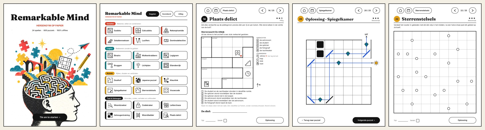

# Remarkable Mind

**Hersengym op papier** — 16 hersenspellen, 400 puzzels en een trainingsplan van 30 dagen, volledig offline op de reMarkable Paper Pro (kleur) en de reMarkable 2 (zwart-wit).



| | |
|---|---|
| **De app voor de Paper Pro** | [`dist/RemarkableMind.pdf`](dist/RemarkableMind.pdf) — kleur, 849 pagina's, 6.020 tikbare links, 4,9 MB |
| **De app voor de reMarkable 2** | [`dist/RemarkableMind-rM2.pdf`](dist/RemarkableMind-rM2.pdf) — grijstinten, zelfde 400 puzzels, 4,6 MB |
| **De promofilm** | [`promo/RemarkableMind-promo.mp4`](promo/RemarkableMind-promo.mp4) — 66 seconden, Nederlands gesproken |

## Wat is het?

De reMarkable heeft geen app-store. Remarkable Mind is daarom gebouwd als één
interactieve PDF: elke knop is een link, je navigeert door te tikken en je lost
op met je pen. Dat werkt op een standaard toestel, zonder developer mode,
zonder account en zonder netwerk.

- **16 spellen in 4 denkspieren**
  - *Getallen*: Sudoku, Calcudoku, Rekenpiramide, Getallenreeksen
  - *Logica*: Binairo, Wolkenkrabbers, Logigram, Bruggen
  - *Ruimte*: Doolhof, Japanse puzzel, Kleurlink, Lucifers
  - *Taal & Geheugen*: Woordzoeker, Codekraker, Letterchaos, Geheugentraining
- **400 puzzels** in drie niveaus (Opwarmen, Pittig, Meesterlijk), 25 per spel.
- **Eén oplossing, nooit gokken**: elke logische puzzel is door een solver
  nagerekend op precies één oplossing.
- **30 dagen hersengym**: elke dag vier puzzels, één per denkspier, met
  oplopende moeilijkheid en afvinkvakjes.
- **Gemaakt voor kleuren-e-ink**: pagina's op exact schermformaat (3:4),
  vette steunkleuren, vectorlijnen, grote tik- en schrijfvlakken.
- **Oplossingen achteraan**, bereikbaar via de knop *Oplossing* op elke puzzel,
  in blauw "handschrift".

## Paper Pro of reMarkable 2?

Beide toestellen hebben een scherm in verhouding 3:4, dus de pagina's vullen
op allebei het hele scherm. De reMarkable 2 toont geen kleur; zijn editie is
daarom apart opgebouwd in grijstinten die op het scherm van elkaar te
onderscheiden blijven:


| | Paper Pro | reMarkable 2 |
|---|---|---|
| Scherm | 11,8 inch, kleur, 1620 × 2160 | 10,3 inch, zwart-wit, 1404 × 1872 |
| Categorieën | vier steunkleuren | vier grijstinten, naam staat er altijd bij |
| Oplossingen | blauw "handschrift" | grijs "handschrift" |
| Kleurlink | gekleurde stippen met letter | zwarte stippen met letter, paden in twee grijzen |
| Doolhof | route in blauw | route als brede grijze band |
| Geheugentraining | vormen in kleur | vormen in zwart, grijs en wit |
| Illustraties | vier inkten | grijsversie waarin de vier inkten te onderscheiden blijven |

De logische puzzels zijn in beide edities identiek. Alleen de vormenpuzzels
van Geheugentraining verschillen, omdat ze daar naar tinten vragen in plaats
van naar kleuren. Door het kleinere scherm is alles op de reMarkable 2 ongeveer
13% kleiner dan op de Paper Pro.

## Op je reMarkable zetten

1. Download [`dist/RemarkableMind.pdf`](dist/RemarkableMind.pdf) (Paper Pro)
   of [`dist/RemarkableMind-rM2.pdf`](dist/RemarkableMind-rM2.pdf) (reMarkable 2).
2. Sleep het bestand in de reMarkable-app (desktop of mobiel), of zet het
   over via USB (in *Settings → Storage* de *USB web interface* aanzetten en
   in je browser naar `http://10.11.99.1` gaan).
3. Open het boek, verberg de werkbalk en tik op *Tik om te starten*.

Tips: tik met je vinger op knoppen, schrijf met de pen. Je inkt staat los van
het boek, dus wissen of een nieuwe laag gebruiken maakt een puzzel weer leeg.

## Zelf een nieuwe editie bouwen

Elke editie is een compleet nieuw boek met 400 andere puzzels.

```bash
pip install -r requirements.txt
```

```bash
python -m mind.book --seed 2027 --out dist/RemarkableMind-2027.pdf
```

Dezelfde editie voor de reMarkable 2:

```bash
python -m mind.book --seed 2027 --device rm2 --out dist/RemarkableMind-2027-rM2.pdf
```

```bash
python -m pytest -q
```

Eén spel bekijken op schermresolutie (voeg `--device rm2` toe voor de
reMarkable 2):

```bash
python -m mind.preview sudoku --out build/preview
```

## Hoe het in elkaar zit

```
mind/
  theme.py        formaat, kleuren, lettertypes en de toestelprofielen
  draw.py         tekenhulpen (rooster, knoppen, pictogrammen)
  pages.py        navigatiebalk, puzzel- en oplossingspagina
  book.py         cover, startscherm, hubs, dagplan, scorebord + PDF-opbouw
  games/          één module per spel: generate(), verify(), draw(), icon()
  assets/         e-ink-versies van de illustraties
  fonts/          Fraunces, Inter, Caveat (SIL OFL)
tests/            per spel: geldig, uniek, deterministisch; plus de navigatie
promo/            artwork, clips, voice-over, muziek en make_film.py
tools/            prepare_assets.py
```

Een nieuw spel toevoegen is één bestand in `mind/games/` dat de klasse `Game`
uit `mind/games/base.py` invult, plus de sleutel in `ORDER` in
`mind/games/__init__.py`.

## De promofilm

`promo/make_film.py` monteert de film volledig uit code:

- vier geanimeerde scènes en al het artwork zijn gegenereerd met ElevenLabs
  (beeld → video), in één risografie-stijl met vier inkten;
- de voice-over (Vlaamse stem) en de muziek komen van ElevenLabs;
- alle schermen in de film zijn echte pagina's uit de PDF;
- de montage volgt de muziek: de onrustige intro eindigt op 5,7 s, de groove
  start op 11,4 s en het slotakkoord valt op 62,9 s.

```bash
python promo/make_film.py
```

## Credits

- Illustraties, videoclips, stem en muziek: gegenereerd met ElevenLabs.
- Lettertypes: Fraunces, Inter en Caveat (SIL Open Font License, zie `mind/fonts/`).
- PDF: ReportLab en PyMuPDF.

reMarkable is een merk van reMarkable AS. Dit is een onafhankelijk project,
niet verbonden met of goedgekeurd door reMarkable AS.
